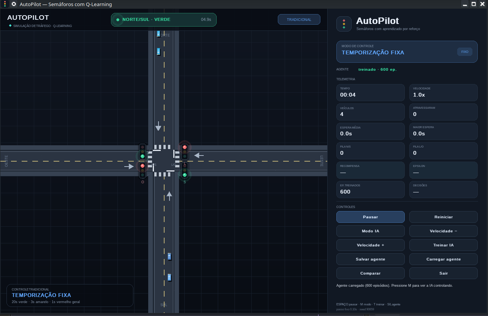

# AutoPilot — semáforos com Q-Learning

<p align="center">
  
</p>

Simulador local de trânsito em Python. Um agente tabular de Q-Learning controla
um cruzamento de quatro vias e é comparado, com as mesmas sementes e a mesma
demanda, a um controlador de tempo fixo.

O projeto não usa APIs externas, LLM, serviços pagos ou GPU. Toda a física, a
recompensa e as métricas vêm da própria simulação.

## Requisitos

- Python 3.10 ou superior (testado com Python 3.14)
- Linux, macOS ou Windows
- `numpy`, `pygame-ce` e `matplotlib`

## Instalação

A partir da raiz do projeto:

```bash
python3 -m venv .venv
source .venv/bin/activate
python -m pip install --upgrade pip
python -m pip install -r autopilot/requirements.txt
```

No Windows (PowerShell), a ativação é:

```powershell
py -m venv .venv
.\.venv\Scripts\Activate.ps1
python -m pip install -r autopilot\requirements.txt
```

## Executar a interface

```bash
python -m autopilot.main
```

Também é possível executar diretamente:

```bash
python autopilot/main.py
```

A interface abre no modo tradicional. Se existir uma Q-table em
`autopilot/models/q_table.npz`, ela é carregada automaticamente e fica
disponível ao pressionar `M` para alternar para o modo IA.

### Controles

| Tecla / botão | Ação |
|---|---|
| `Espaço` | pausa / continua |
| `R` | reinicia a sessão com outra seed |
| `M` | alterna entre controle tradicional e IA |
| `+` / `-` | aumenta / diminui a velocidade da simulação |
| `T` | inicia ou interrompe o treinamento em background |
| `S` | salva a Q-table |
| `L` | carrega a Q-table salva |
| `C` | inicia a comparação; fecha o resultado quando ele está aberto |
| `Esc` | fecha a comparação ou encerra o programa |

Os mesmos comandos estão disponíveis nos botões do painel lateral.

### O que aparece na tela

- Cruzamento visto de cima, com veículos em movimento e semáforos animados.
- Fase ativa, tempo no estado atual e indicação da última decisão da IA.
- Painel com modo, tempo, veículos ativos, veículos que atravessaram, espera
  média, maior espera, filas por eixo, recompensa, epsilon, episódios treinados
  e número de decisões.
- Aviso explícito quando o modo IA é usado sem uma Q-table treinada. Nesse caso
  a fase só muda por segurança (verde máximo), jamais por uma decisão aleatória
  apresentada como aprendizado.

## Treinar

O treinamento roda sem renderização, em passo fixo, e mostra o progresso no
terminal. Checkpoints são salvos a cada 50 episódios e a Q-table final é gravada
em `autopilot/models/q_table.npz`.

```bash
# Configuração padrão: 600 episódios de 240 s simulados, seed 1
python -m autopilot.main --train

# Exemplo curto
python -m autopilot.main --train --episodes 100 --seconds 120 --seed 7

# Continuar a partir da Q-table existente
python -m autopilot.main --train --resume --episodes 200
```

Opções úteis:

```text
--episodes N        número de episódios de treino
--seconds S         duração simulada de cada episódio
--seed N            seed base do treinamento
--model CAMINHO     caminho da Q-table (.npz)
--resume            continua o treinamento a partir da Q-table
```

O treinamento pode ser interrompido com `Ctrl+C` ou pelo botão **Parar treino**.
A interrupção acontece ao fim do episódio corrente e a Q-table é salva antes de
o programa retornar.

## Avaliar

```bash
# Comparação padrão: 16 episódios de 240 s, seeds 10000..10015
python -m autopilot.main --evaluate

# Exemplo curto
python -m autopilot.main --evaluate --eval-episodes 8 --seconds 120

# Sem gerar o PNG
python -m autopilot.main --evaluate --no-chart
```

Treinar e avaliar na mesma execução:

```bash
python -m autopilot.main --train --evaluate
```

A avaliação é justa por construção:

- o controlador tradicional e a IA usam exatamente a mesma lista de seeds;
- a agenda de chegadas é idêntica nos dois modos;
- os dois episódios têm a mesma duração;
- a IA é avaliada de forma **gananciosa** (`epsilon = 0`), sem exploração;
- a Q-table não sofre nenhuma atualização durante a avaliação.

Artefatos gerados:

- `autopilot/models/evaluation.json` — métricas agregadas e detalhadas por seed;
- `autopilot/models/evaluation.png` — gráfico comparativo em quatro painéis.

Métricas reportadas: tempo médio de espera, veículos atendidos por episódio,
fila média e maior espera registrada. Nenhum número é inventado: todos são
calculados a partir dos contadores da simulação.

### Resultado medido nesta entrega

Modelo atual: 600 episódios de treino, 240 s por episódio, seed 1.
Avaliação: 16 episódios de 240 s, seeds 10000 a 10015, IA sem exploração.

| Métrica | Tradicional | IA | Diferença |
|---|---:|---:|---:|
| Tempo médio de espera | 10,59 s | 10,13 s | −0,47 s |
| Veículos atendidos por episódio | 139,25 | 137,81 | −1,44 |
| Fila média | 8,23 | 8,24 | +0,02 |
| Maior espera registrada | 45,20 s | 45,20 s | 0,00 s |

A IA teve espera média cerca de 4,4% menor, mas atendimento médio cerca de 1%
menor e fila média praticamente igual. O resultado varia por seed: a IA foi
melhor em algumas e pior em outras. Portanto, esta entrega **não afirma
superioridade garantida**; ela mostra o comportamento medido do agente treinado
e permite reproduzir a comparação.

Recompensa média da IA na avaliação: 59,26 por episódio. Trocas de fase: 15,6
por episódio. A Q-table salva registra 21.638 decisões de treinamento.

## Como o agente aprende

O Q-Learning é tabular e atualiza a Q-table a cada decisão durante o treino:

```text
Q(s, a) <- Q(s, a) + alpha * [r + gamma^elapsed * max Q(s', a') - Q(s, a)]
```

O desconto `gamma^elapsed` usa o tempo simulado entre decisões. Isso compara de
forma justa intervalos de durações diferentes, inclusive os que contêm amarelo
e vermelho geral.

### Estado

Seis dimensões discretas, total de `4 x 4 x 4 x 2 x 2 x 4 = 1024` estados:

1. fila no eixo Norte/Sul;
2. fila no eixo Leste/Oeste;
3. espera média dos veículos parados;
4. fase ativa (N/S ou L/O);
5. verde mínimo já cumprido;
6. tempo de verde atual.

### Ações

- `0` — manter a fase atual;
- `1` — solicitar a troca de fase.

A troca só é aplicada quando o semáforo está em verde e o verde mínimo foi
cumprido. Em seguida vêm amarelo e vermelho geral. A fase oposta só recebe verde
depois que o cruzamento está vazio. O ambiente nunca permite dois verdes
conflitantes.

### Recompensa

Calculada a partir de eventos reais do intervalo:

| Evento | Valor |
|---|---:|
| Veículo que atravessa | `+1,00` |
| Veículo parado por segundo | `−0,02` |
| Veículo médio na fila | `−0,05` |
| Fila média acima de 12 veículos | `−0,03` por veículo excedente |
| Troca de fase aplicada | `−2,00` |

### Hiperparâmetros

| Parâmetro | Valor |
|---|---:|
| Taxa de aprendizado (`alpha`) | 0,15 |
| Desconto (`gamma`) | 0,97 |
| Epsilon inicial | 1,00 |
| Epsilon mínimo | 0,05 |
| Decaimento por episódio | 0,995 |
| Intervalo de decisão da IA | 2 s |
| Verde mínimo / máximo | 8 s / 40 s |

## Simulação

- Passo fixo de `0,1 s`; o FPS só controla a renderização.
- Chegadas de Poisson independentes por aproximação, com fatores de demanda
  variáveis.
- Veículos andam em linha reta, aceleram e freiam, respeitam distância de
  segurança e obedecem ao semáforo.
- Veículos saem da tela ao percorrer a via e entram nas métricas de atendimento.
- Não há fluxos conflitantes nem sobreposição de veículos: além do modelo de
  seguimento, existe uma garantia dura de não sobreposição a cada passo.
- O mesmo seed produz a mesma agenda de chegadas nos modos tradicional e IA.

## Testes

```bash
python -m unittest discover -s autopilot/tests -v
```

A suíte cobre:

- ciclo e segurança do semáforo (amarelo, vermelho geral, verdes conflitantes);
- movimento, distância segura, determinismo e saída de veículos;
- componentes da recompensa;
- atualização de Bellman, desconto por tempo, epsilon e persistência da Q-table;
- determinismo do ambiente e justiça da avaliação;
- fumaça da interface Pygame em modo headless.

Para rodar os testes de interface sem abrir uma janela:

```bash
SDL_VIDEODRIVER=dummy SDL_AUDIODRIVER=dummy \
  python -m unittest discover -s autopilot/tests -v
```

## Estrutura

```text
autopilot/
├── main.py            # CLI e aplicação Pygame
├── simulation.py      # física, chegadas, filas e métricas
├── vehicle.py         # modelo do veículo
├── traffic_light.py   # máquina de estados segura do semáforo
├── environment.py     # observação, recompensa e episódios de RL
├── agent.py           # Q-Learning tabular e persistência
├── training.py        # treino acelerado e thread de background
├── evaluation.py      # comparação justa, relatório e gráfico
├── renderer.py        # desenho da interface
├── config.py          # todos os parâmetros centralizados
├── requirements.txt
├── models/
│   ├── q_table.npz
│   ├── evaluation.json
│   └── evaluation.png
└── tests/
```

## Solução de problemas

**`ModuleNotFoundError: No module named 'autopilot'`**
Execute os comandos a partir da raiz do projeto (a pasta que contém
`autopilot/`).

**A janela não abre em servidor ou ambiente sem display**
A interface precisa de um display gráfico. Para testes automatizados, use
`SDL_VIDEODRIVER=dummy`.

**Treinamento muito lento**
Reduza `--episodes` ou `--seconds`. O treinamento é single-thread de propósito
para manter a reprodutibilidade; para mudar a frequência de checkpoints, edite
`checkpoint_every` em `autopilot/config.py`.

**A IA parece não decidir**
Confirme se há uma Q-table treinada (`autopilot/models/q_table.npz`) e use `M`
para entrar no modo IA. Sem treino, o painel mostra um aviso e a fase só muda
por segurança.

## Reprodutibilidade

- Sementes explícitas no treino, na avaliação e na interface (`--gui-seed`).
- Apenas as chegadas consomem o RNG da simulação, então a agenda é comparável
  entre os modos.
- A avaliação não altera a Q-table.
- O relatório JSON guarda as métricas por seed, além dos agregados.
